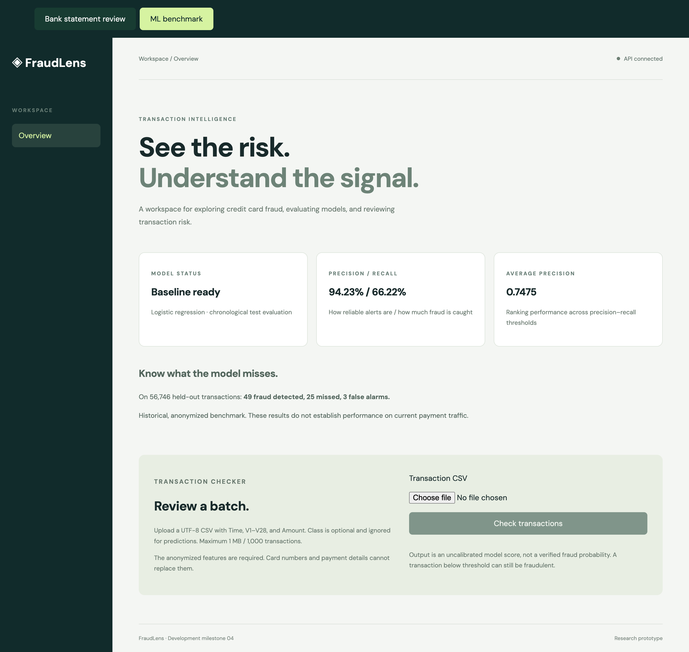
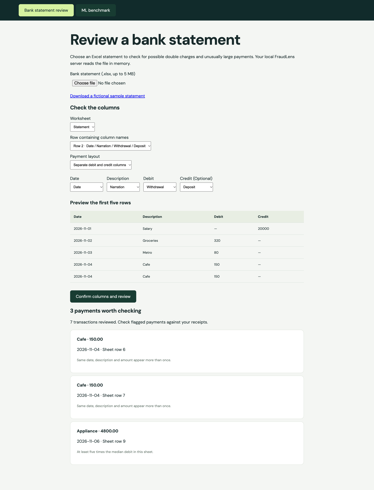

# FraudLens

Credit card fraud detection, built end to end: a reproducible ML pipeline, a FastAPI backend, and a React dashboard.

FraudLens has two parts:

1. **ML benchmark.** A model trained on the ULB credit card fraud dataset, evaluated honestly on a time-ordered held-out test set, and served through an API for batch scoring.
2. **Bank statement review.** Upload an Excel statement and get possible duplicate charges and unusually large payments flagged by simple rules. This part has no fraud labels, so its accuracy is unknown; it is a review aid, not a detector.

> Research prototype. Not a payment authorization system. Never upload real card numbers, CVVs, or customer identifiers.





## Results

Logistic regression baseline on the **held-out test set** (56,746 transactions, 74 fraud), evaluated once, with the threshold chosen on validation only:

| Fraud caught | Fraud missed | False alarms | Precision | Recall | F1 | Average precision |
|---|---|---|---|---|---|---|
| 49 | 25 | 3 | 94.2% | 66.2% | 77.8% | 0.747 |

That is about 1 alert per 1,000 transactions, and 49 of every 52 alerts are real fraud.

### What I tried next, and what I learned

**Lowering the threshold.** On validation (57 fraud), catching 46 instead of 40 cost 109 false alarms; catching 52 cost 7,648. The missed fraud scores like ordinary transactions, so a looser cutoff floods reviewers. See `reports/threshold_comparison.json`.

**A stronger model.** I compared `HistGradientBoostingClassifier` against the baseline at fixed false-alarm budgets, each with its own validation-selected threshold, settings chosen using chronological folds inside training only, and the test set never scored:

| Max false alarms (validation) | Logistic regression caught | Gradient boosting caught |
|---|---|---|
| 3 | **40** / 57 | 38 / 57 |
| 10 | 41 / 57 | 41 / 57 |
| 25 | **44** / 57 | 43 / 57 |

Gradient boosting won three of four training folds but lost on the most recent fold and on validation. With only 57 fraud cases, a gap of one or two detections is noise (paired exact test p = 0.69; bootstrap range −6 to +7). **Result: no improvement, so the baseline stays.** See `reports/experiments/model_comparison.json`.

## How the evaluation stays honest

- **Time-ordered split** 60/20/20 (train/validation/test). Transactions with the same timestamp stay in the same split, so the model never learns from the future.
- **Exact duplicates removed** (1,081 rows) before splitting, so the same transaction cannot appear in both training and test.
- **Scaler fitted on training data only.**
- **Thresholds chosen on validation only.** The test set is scored once and never used for tuning.
- **Precision, recall, and average precision** instead of accuracy. With 0.17% fraud, a model that flags nothing is 99.8% accurate.
- **Dataset fingerprint check.** Every report records the dataset's SHA-256, and scripts refuse to run if the model and data do not match.

## Tech stack

Python · scikit-learn · pandas · FastAPI · Pydantic · React 19 · Vite · pytest

## Run locally

Requirements: Python 3.11–3.14 (3.12 or 3.13 recommended) and Node.js 22.12+.

### 1. Get the data and train

Download `creditcard.csv` from the [ULB credit card fraud dataset on Kaggle](https://www.kaggle.com/datasets/mlg-ulb/creditcardfraud) and place it in `data/raw/`. The dataset is not included in this repository.

```sh
python3 -m venv .venv
source .venv/bin/activate
python -m pip install -e '.[dev,ml]'
python -m ml.data.validate                  # writes reports/data_validation.json
python -m ml.training.train                 # writes reports/baseline_metrics.json and models/baseline.joblib
python -m ml.training.compare_thresholds    # optional: validation threshold tradeoffs
python -m ml.training.compare_models        # optional: model comparison (~80 s)
```

### 2. Start the API

```sh
cp .env.example .env
python -m uvicorn backend.app.main:app --reload
```

API health: http://localhost:8000/api/health · Interactive docs: http://localhost:8000/docs

### 3. Start the dashboard

```sh
cd frontend
npm install
npm run dev
```

Open http://127.0.0.1:5173. Try the statement review with `frontend/public/sample-statement.xlsx` (fictional data).

### Tests

```sh
python -m pytest
cd frontend && npm run build
```

Backend prediction tests need the trained model, its report, and the dataset.

## API

| Method | Endpoint | Purpose |
|---|---|---|
| GET | `/api/health` | Service and model status |
| GET | `/api/model` | Features and saved evaluation report |
| POST | `/api/predict` | Score one transaction (JSON, all 30 features) |
| POST | `/api/predict/csv` | Score up to 1,000 rows (`text/csv`, max 1 MB; optional `Class` column is ignored) |
| POST | `/api/statement/workbook` | Read an `.xlsx` statement (max 5 MB) for rule-based review |

Uploads are processed in memory and never saved. Scores are uncalibrated model scores, not fraud probabilities.

## Project structure

```
backend/app/    FastAPI routes, schemas, model loading
frontend/src/   React dashboard and statement review
ml/data/        Dataset validation
ml/training/    Training, threshold and model comparison experiments
reports/        Saved metrics (JSON); experiments/ holds exploratory results
docs/           Architecture and milestones
data/, models/  Local only, excluded from Git
```

## Limitations

- The dataset covers two days of anonymized European card transactions from 2013. Results do not show how the model would perform on current payment traffic.
- Features V1–V28 are anonymized PCA components, so the model cannot score a normal card payment form.
- There are no customer IDs, so the split cannot guarantee that the same customer never appears in both training and test.
- The threshold maximizes validation F1. A real deployment would set it from the actual costs of missed fraud and manual reviews.
- The API has no authentication and is meant for local use only.
- Only load `joblib` model files you trust, because loading one can execute code.

## Dataset credit

Andrea Dal Pozzolo, Olivier Caelen, Reid A. Johnson and Gianluca Bontempi. *Calibrating Probability with Undersampling for Unbalanced Classification.* IEEE Symposium on Computational Intelligence and Data Mining (CIDM), 2015. Dataset by the Machine Learning Group, Université Libre de Bruxelles (ULB). Check the Kaggle page for its license terms.

## License

Code: [MIT](LICENSE). The dataset is not covered by this license.
